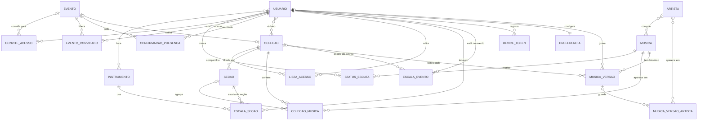

# Arquitetura e modelo de dados

## Stack técnica

| Camada | Escolha |
|---|---|
| Frontend e backend | **Next.js 15** (App Router) + **React 19**, tudo em **TypeScript** (`strict`) |
| API | Route Handlers do Next (`src/app/api/**/route.ts`) |
| Banco | **PostgreSQL padrão** (Supabase em produção, usado só como banco; Postgres em Docker em desenvolvimento; também em contêiner, se o app rodar fora da Vercel) |
| ORM | **Prisma 6**, com o schema gerado do banco (`prisma db pull`) |
| Validação | **Zod** |
| Interface | **Material UI** (MUI) com Emotion (`@mui/material`, `@mui/material-nextjs`, `@mui/icons-material`), com o tema da paleta de [Design](design.md). Sem Tailwind |
| Autenticação | **JWT** (biblioteca `jose`, que roda também no middleware) em cookie `httpOnly`, senhas com **scrypt** (`node:crypto`, sem dependência extra); segundo fator **TOTP** (RFC 6238, implementado com `node:crypto`, QR code com `qrcode`) e segredo criptografado com AES-256-GCM; login com Google por OpenID Connect (`openid-client`) |
| Qualidade | **Vitest** (unitários e integração), **Playwright** (ponta a ponta), **ESLint** e **Prettier**, com **GitHub Actions** |
| Drag-and-drop | **dnd-kit** (`@dnd-kit/core`, `@dnd-kit/sortable`, `@dnd-kit/utilities`) |
| Push | Web Push + VAPID (biblioteca `web-push`) |
| Fotos de perfil | **Postgres** (tabela `fotos_perfil`), redimensionadas no servidor com **sharp** |
| Lembretes | **Vercel Cron** |
| Exportação | Markdown como texto; PDF gerado por código com `pdf-lib` e fontes embutidas (monoespaçada para a cifra, proporcional para a letra). Sem navegador headless. |
| E-mail | **Resend** (plano gratuito), isolado em `src/lib/email.ts` para poder ser trocado |
| Busca | PostgreSQL com `pg_trgm` e `unaccent`, em consultas SQL parametrizadas (`$queryRaw`) |
| Documentação da API | **Swagger / OpenAPI**, público |
| Deploy | **Vercel** (deploy automático por push no GitHub) |

Tudo num único projeto TypeScript (front e back), sem plataformas além de Vercel, GitHub e Supabase (o Resend, só para e-mail).

### Decisões de arquitetura

| Decisão | Motivo |
|---|---|
| Autenticação própria (JWT em cookie `httpOnly`) | Atende convites de 7 dias e códigos de recuperação, que exigem fluxos próprios. O Supabase entra só como banco. |
| Material UI, sem Tailwind | Um só sistema de componentes e de estilo: tema (cores, tipografia, claro e escuro), foco, acessibilidade e pontos de quebra vêm prontos, e não há duas formas de estilizar a mesma tela. O `create-next-app` é chamado com `--no-tailwind`. Os estilos do Emotion usam o `nonce` da CSP. |
| Cifra guardada em graus | Uma única fonte serve qualquer tom. O tom original e o tocado são informações à parte. |
| PDF gerado no código, com `pdf-lib` | Mantém o texto selecionável, com fontes embutidas, e roda na Vercel sem navegador. |
| Busca com `pg_trgm` e `unaccent` | Os títulos são curtos e a busca é por trecho. Trigramas atendem sem depender de raízes de palavras. |
| Fotos no Postgres | Mantém menos peças (RNF08), e a foto é pequena (256 px). |
| Resend atrás de `src/lib/email.ts` | O plano gratuito basta, e a camada própria permite trocar de provedor. |
| Prisma com `db pull` e `$queryRaw` | O `DDL.sql` é a fonte da verdade, e a busca usa funções que o Prisma não expressa. |
| `ordem` decimal (média dos vizinhos) | Reordenar atualiza uma única linha (RNF04). |
| Contador `versao` | Detecta edição simultânea sem travar ninguém (RNF13). |
| Limite de tentativas no banco | A Vercel não guarda memória entre requisições, e a hospedagem fica restrita às plataformas da RNF08 (RNF15). |
| Cache de cliente (service worker, só com os arquivos do app) e downloads pelo botão **Baixar** (IndexedDB), só leitura offline | O volume é pequeno e o offline não edita, então não há conflito a resolver. Os dados só ficam no aparelho quando a pessoa os baixa, para ela saber o que tem guardado e o que apagar. Cache de servidor não se justifica nesse porte. |
| Banco relacional (PostgreSQL) | O modelo se conecta por chaves e precisa de transações, como no histórico. Campos de estrutura livre usam `JSONB`. |
| Contêiner opcional (`Dockerfile` e `docker-compose.yml`) | O app não guarda estado em disco, então roda igual na Vercel e em contêiner. Quem prefere uma VPS ou Coolify não precisa reescrever nada. A Vercel segue como hospedagem principal (RNF08). |

## Modelo de dados

31 tabelas e 2 views, definidas em **`DDL.sql`** (PostgreSQL 13 ou superior). O arquivo tem quatro partes: a **parte 1** (tabelas, chaves e únicas) é a mais segura para visualizadores como o Esquema 3D; a **parte 2** (CHECKs e índices), a **parte 3** (views) e a **parte 4** (instrumentos iniciais) podem ser apagadas se o visualizador não as reconhecer.

Os itens principais (usuários, instrumentos, artistas, músicas, eventos e coleções) têm `criado_em` e `atualizado_em`, e o banco mantém `atualizado_em` por trigger. Também têm data o histórico (`musica_versoes.criado_em`), `eventos.data_evento`, `convites_acesso.expira_em`, `codigos_email.expira_em` e `limites_tentativas.janela_fim`, todas com fuso (`TIMESTAMPTZ`). A parte 2 cria as extensões `pg_trgm` e `unaccent` e a função `busca_norm`, usadas na busca (veja [Busca e ordenação](api.md#busca-e-ordenação)).

| Tabela | Propósito |
|---|---|
| `usuarios` | Pessoas. `papel` (`COORDENADOR`, `MINISTERIADO` ou `CONVIDADO`), `ativo` (vazio para convidados), `slug`, `sexo` (`FEMININO` ou `MASCULINO`, para o cargo no gênero da pessoa), hash da senha, `token_versao` (invalida as sessões antigas quando a senha muda), versão e data do aceite dos termos (`termos_versao`, `termos_aceitos_em`) e o segundo fator (`totp_segredo` criptografado, `totp_ativo`, `totp_ultimo_passo`). |
| `preferencias_usuario` | A configuração de visualização e de exportação de cada pessoa (RN91): padrão da tela (cifra ou letra), seções na letra, tamanho da fonte, formato dos graus, modo Reduzido, tema, aviso de "Não vou" e padrão do arquivo exportado. Uma linha por pessoa, guardada na conta. |
| `emails_usuario` | Os e-mails de cada pessoa: o principal (obrigatório) e o de recuperação (opcional), únicos no sistema e em minúsculas. Só entram os confirmados por código. `tipo` é `PRINCIPAL` ou `RECUPERACAO`. |
| `contas_google` | O vínculo com uma conta Google, para o login com Google (um por conta). |
| `fotos_perfil` | A foto de perfil de cada pessoa, em bytes (`BYTEA`), já redimensionada, com o tipo MIME. Uma por usuário, no máximo. |
| `codigos_email` | Códigos de 6 dígitos enviados por e-mail, só o hash. `finalidade` é `CADASTRO` (antes da conta existir), `REDEFINICAO`, `TROCA_EMAIL` ou `EXCLUSAO_CONTA`. Tem expiração de 15 minutos a partir do envio e contador de `tentativas`; a linha é apagada ao usar o código. |
| `codigos_recuperacao` | Os 10 códigos de recuperação de cada pessoa, só o hash, e se cada um já foi usado. |
| `codigos_backup_totp` | Os 10 códigos de backup do segundo fator de cada pessoa, só o hash, e se cada um já foi usado. |
| `configuracoes_app` | Configurações editáveis em tempo de execução (chave e valor): nome e logo do ministério (RN105). |
| `instrumentos` | Catálogo de instrumentos, com `nome` e `slug`. |
| `usuarios_instrumentos` | Quais instrumentos cada pessoa toca. |
| `artistas` | Compositores e intérpretes, com `nome` e `slug`, e página própria. |
| `musica_versoes` | O histórico da música: número, título, `tipo` (`MUSICA` ou `TOM_TOCADO`), cifra, tom original e compasso (no tipo `MUSICA`), tom tocado e setlist ou lista (no tipo `TOM_TOCADO`), autor (`usuario_id`), data e de qual versão veio, se foi restaurada. |
| `musica_versoes_artistas` | Os artistas de cada versão do tipo `MUSICA`, em ordem. Guarda a referência ao artista, não o nome. |
| `musicas` | A biblioteca: título, `slug`, cifra em graus, tom original e compasso (opcionais, só informativos), link do YouTube, marca de revisão e `versao`. Sem músicos. |
| `musica_artistas` | Os artistas de cada música, em ordem (`posicao`). Uma música tem pelo menos um. |
| `status_escuta` | Status pessoal por usuário × música. |
| `eventos` | Missas, ensaios, retiros: nome, `slug`, data e hora, `requerir_presenca` e `cancelado`. |
| `eventos_convidados` | Quais eventos cada convidado pode acessar. |
| `convites_acesso` | Convites de uso único: token, cargo, quem criou, evento (só para convidados) e `expira_em` (7 dias). A linha é apagada ao usar o convite. |
| `secao_musicos` | **A escala de cada seção**: quem toca cada seção do setlist. Sem usuário (vazio) em eventos passados quando a conta é apagada. |
| `colecao_musicos` | **A escala do evento**: as pessoas escaladas para o evento inteiro. Sem usuário (vazio) em eventos passados quando a conta é apagada. |
| `confirmacoes_presenca` | Presença por evento × usuário (vazio, vai ou não vai). Fica sem usuário (vazio) quando a conta é apagada. |
| `colecoes` | Setlist (com `publicado`) ou lista. |
| `listas_donos` | Os donos de cada lista, com ordem (`posicao`). O primeiro dono entra no slug. |
| `listas_acessos` | Quem recebeu do dono o acesso de edição de uma lista (editores). |
| `slugs_antigos` | Slugs que deixaram de ser usados por renomeação, para o redirecionamento. |
| `secoes` | Agrupamentos opcionais dentro de uma coleção. |
| `colecao_musicas` | Música na coleção: tom tocado (opcional), cifra local (opcional), ordem e versão. |
| `device_tokens` | Inscrições de push (endpoint, chaves) por usuário. |
| `limites_tentativas` | Contador do limite de tentativas (login, convites, códigos), no banco por causa da Vercel. |

| View | Propósito |
|---|---|
| `vw_execucoes` | Uma linha por música tocada em cada evento. Base das contagens. |
| `vw_ultima_execucao` | Última vez que cada música foi tocada. |

Os ids são `UUID` gerados pelo banco (`gen_random_uuid()`), então um `INSERT` direto no `psql` funciona sem informar o id. A parte 4 do `DDL.sql` cadastra os instrumentos iniciais: Voz, Violão, Guitarra, Baixo, Teclado, Bateria e Cajón.

### Diagrama

(`ESCALA_SECAO` é a tabela `secao_musicos`; `ESCALA_EVENTO`, a `colecao_musicos`; `EVENTO_CONVIDADO`, a `eventos_convidados`; `LISTA_ACESSO`, a `listas_acessos`; `PREFERENCIA`, a `preferencias_usuario`; `MUSICA_VERSAO` e `MUSICA_VERSAO_ARTISTA`, a `musica_versoes` e a `musica_versoes_artistas`.)

### Regras garantidas no banco

Estão na parte 2 do `DDL.sql` e foram testadas tentando violá-las:

- `papel` só aceita `COORDENADOR`, `MINISTERIADO` ou `CONVIDADO`, e `sexo` só aceita `FEMININO` ou `MASCULINO`; convidado tem `ativo` vazio, e os demais têm `ativo` preenchido.
- Convite de convidado exige evento; os outros convites não têm evento.
- O `slug` só aceita minúsculas, números e hífens.
- Nome de instrumento e de artista **únicos sem diferenciar maiúsculas nem acentos** (pela função `busca_norm`).
- Cada e-mail existe uma única vez no sistema, em minúsculas e com formato mínimo. Cada conta tem um e-mail principal e, no máximo, um de recuperação.
- A posição dos artistas de uma música é única, e a música tem pelo menos um.
- O título (sem diferenciar maiúsculas nem acentos) e o conjunto de artistas não se repetem. Um gatilho do banco confere isso no fim da transação (RN34).
- Uma lista com donos não perde o último dono por exclusão direta (gatilho no banco, RN79). Apagar a conta de um dono remove o vínculo em cascata e deixa a lista sem donos, portanto pública (RN79, RN83).
- Tom tocado e tom original no formato `D`, `F#m` ou `Bb`, e compasso no formato `N/D` (como `4/4` ou `6/8`).
- Nomes e títulos não vazios, e link do YouTube começando com `http://` ou `https://`.
- Cada versão tem número único por música e título não vazio. Uma versão `MUSICA` não tem setlist; uma `TOM_TOCADO` tem setlist e não tem cifra. Tons válidos em todas. Data de criação e atualização são mantidas pelo banco.
- A configuração aceita só `CIFRA` ou `LETRA` para visualização e exportação, só `PEQUENA`, `MEDIA` ou `GRANDE` para a fonte, só `NUMEROS` ou `ROMANOS` para o formato dos graus e só `CLARO`, `ESCURO` ou `AUTOMATICO` para o tema.
- A cifra tem no máximo 20.000 caracteres em `musicas`, `colecao_musicas` e `musica_versoes` (RN102).
- Em `colecoes`: SETLIST exige evento e não tem nome; LISTA exige nome, não tem evento e não é publicada. Os donos de uma lista ficam em `listas_donos`; uma lista sem donos é pública.
- Toda mudança em seções, itens e escala de uma coleção renova `colecoes.atualizado_em` (gatilho), base da atualização dos downloads (RN110).
- Instrumento em uso e música usada em setlist ou lista não podem ser apagados (`RESTRICT`).
- O convite expira 7 dias depois de criado, por padrão do banco.
- A finalidade de `codigos_email` é `CADASTRO` (sem usuário), `REDEFINICAO`, `TROCA_EMAIL` ou `EXCLUSAO_CONTA` (com usuário).
- `token_versao` começa em 1.

### Regras que a API valida

O banco não cobre estas:

- A seção de uma música pertence à mesma coleção da música.
- Apenas coordenadores convidam, alteram cargos, criam eventos e desativam e reativam contas. Ninguém além da própria pessoa apaga a conta, vê e-mails ou altera nome, sexo, foto e instrumentos dela (RN05, RN77).
- Conta desativada não edita nada: só visualiza e confirma presença.
- O convidado só lê (exceto conta, instrumentos e presença) e só tem acesso enquanto está em ao menos um evento de `eventos_convidados`.
- Uma lista é editada pelos donos e pelos editores (`listas_acessos`). Só os donos apagam a lista e gerenciam donos e acessos. Com **Edição pública** marcada, ou sem donos, todo membro ativo a edita; só coordenadores apagam uma lista sem donos (RN79). Só membros ativos e não convidados recebem qualquer papel nela. Todas as listas aparecem para todos os usuários logados (RN79).
- Os e-mails de uma pessoa só são devolvidos para ela.
- O login aceita o e-mail principal ou o de recuperação, ambos confirmados; os códigos de redefinição e de troca vão ao endereço escolhido.
- A gravação só é aceita se a `versao` enviada ainda for a atual.
- Nomes reservados pelas rotas não são aceitos como `slug`.
- Um código de e-mail ou de recuperação serve uma única vez. O código de e-mail é invalidado após o limite de tentativas.

### Evolução do esquema

- O `DDL.sql` descreve o esquema completo e atual. Serve para criar um banco novo (desenvolvimento, testes e o primeiro deploy).
- Depois do primeiro deploy, cada mudança no banco é um script numerado em `db/migracoes/` (`0001_descricao.sql`, `0002_…`), aplicado em ordem em todos os ambientes. O mesmo commit atualiza o `DDL.sql`, para que ele continue igual ao resultado de todas as migrações.
- Cada script roda em uma transação e é revisado como código. Uma mudança destrutiva (apagar coluna ou tabela) acontece em dois lançamentos: primeiro o código deixa de usar, depois o script remove.
- Depois de uma migração, rode `npx prisma db pull` e inclua o `schema.prisma` atualizado no mesmo commit.
- Antes de aplicar em produção, faça um backup (veja [Deploy](desenvolvimento.md#deploy)) e teste o script em um banco criado com o `DDL.sql` anterior.

